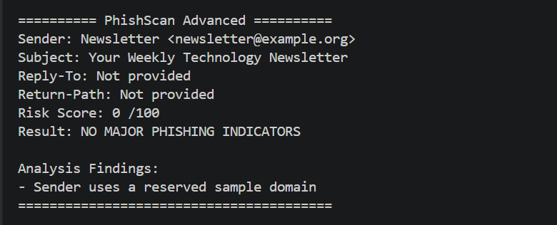
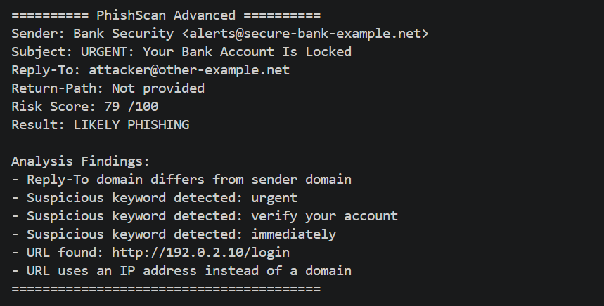

# PhishScan

PhishScan is a Python-based phishing email analysis tool that identifies suspicious email characteristics using rule-based detection.

## Screenshots

### 1. Fake eSewa KYC Email Analysis

### 2. Legitimate Newsletter Analysis

### 3. Fake Bank Alert Analysis

## Features

- Email sender analysis
- Suspicious keyword detection
- URL identification
- IP-based URL detection
- Reply-To domain mismatch detection
- Return-Path comparison
- Email authentication failure indicators
- Risk score calculation
- Detailed analysis findings

## Project Structure

    phishscan/
    |-- phishscan.py
    |-- phishscan_simple.py
    |-- README.md
    |-- samples/
        |-- fake_esewa_kyc.eml
        |-- legit_newsletter.eml
        |-- fake_bank_alert.eml

## Requirements

- Python 3
- Windows, Linux or macOS

No external Python packages are required.

## Installation

Clone the repository:

    git clone https://github.com/YOUR-USERNAME/phishscan.git

Navigate into the project:

    cd phishscan

## Usage

Run the simple version:

    python phishscan_simple.py samples/fake_esewa_kyc.eml

Run the advanced version:

    python phishscan.py samples/fake_esewa_kyc.eml

Test a legitimate email:

    python phishscan.py samples/legit_newsletter.eml

Test a bank phishing email:

    python phishscan.py samples/fake_bank_alert.eml

## Detection Results

| Test Email | Risk Score | Result |
|---|---:|---|
| Fake eSewa KYC | 50/100 | Likely Phishing |
| Legit Newsletter | 0/100 | No Major Indicators |
| Fake Bank Alert | 79/100 | Likely Phishing |

## How It Works

PhishScan reads .eml email files and examines sender information, headers, message content and URLs.

It uses predefined rules to identify suspicious characteristics and calculates a risk score based on detected indicators.

## Limitations

- Uses rule-based detection.
- Risk scores are heuristic indicators, not actual phishing probabilities.
- Does not verify domain ownership or website reputation.
- Does not perform live SPF, DKIM or DMARC verification.
- A low score does not guarantee that an email is safe.

## Disclaimer

This project is developed for educational and cybersecurity learning purposes. The included email samples are fictional and should only be used for testing.

## Author

Smriti Rai
